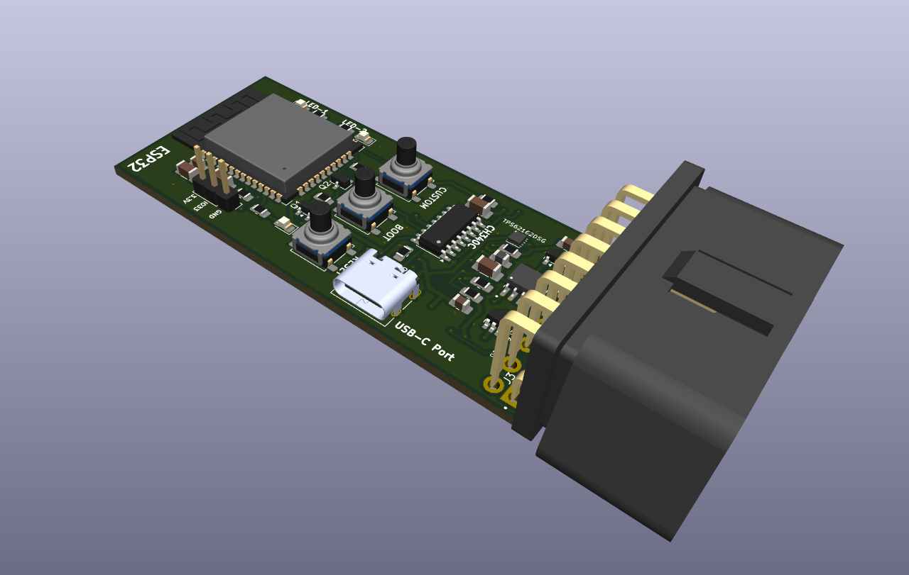
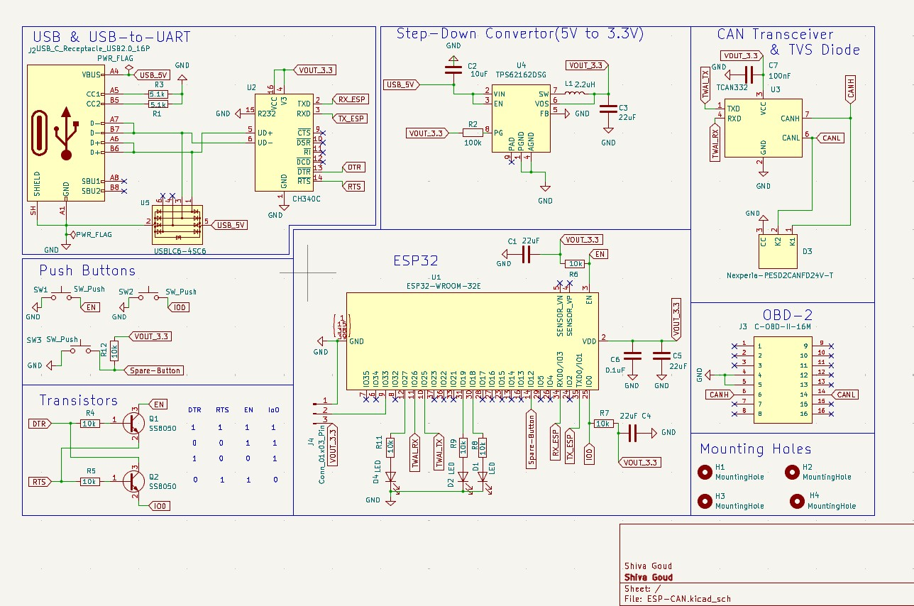
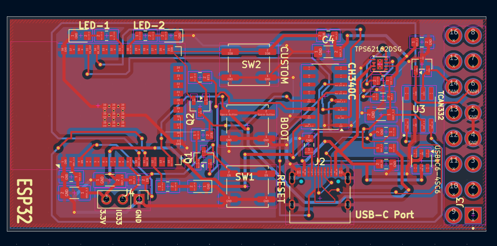
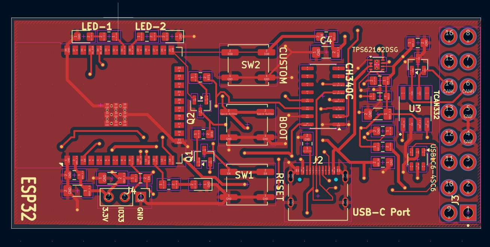
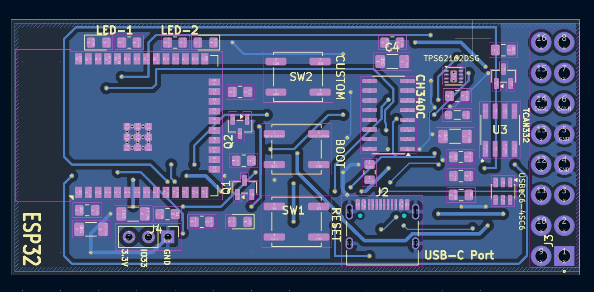
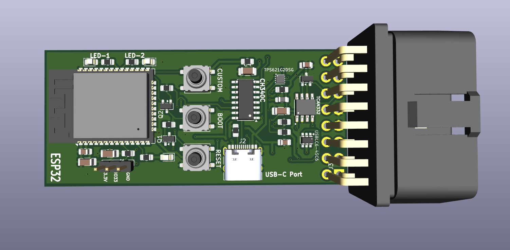
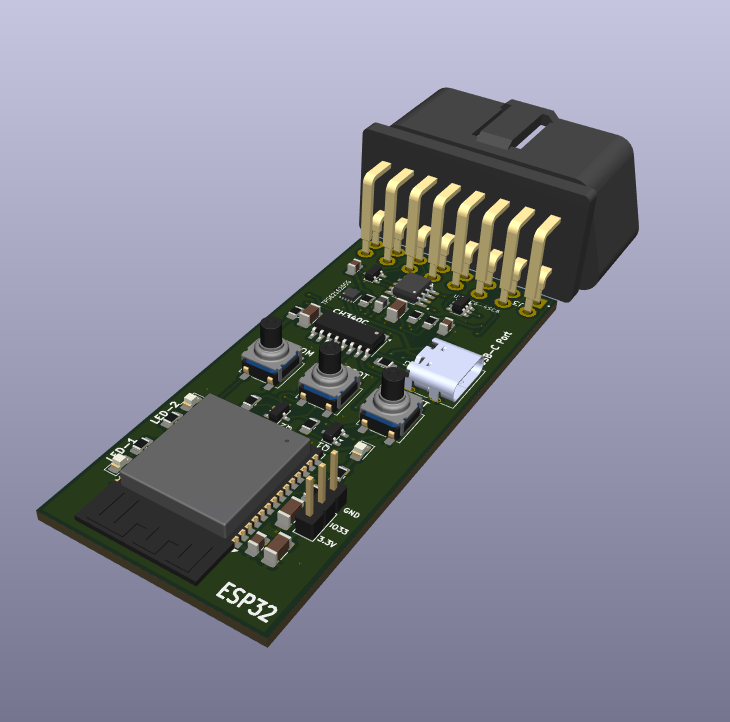
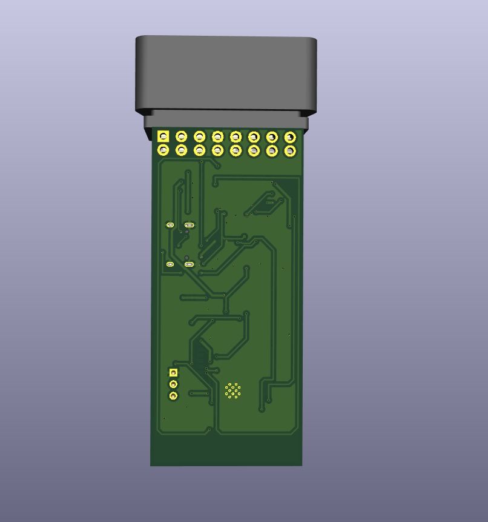

# Wireless OBD Dongle for Automotive Diagnostics

A custom ESP32-based wireless OBD-II dongle designed to interface with a vehicle's diagnostic port and provide a hardware platform for automotive data acquisition and diagnostics.

This repository currently contains the **KiCad hardware design**: the schematic, PCB layout, supporting symbol/footprint libraries, and 3D component models.

<p align="center">
  
</p>

## Project overview

The board is built around an **ESP32-WROOM-32E** module and a **TCAN332 CAN transceiver**. The OBD-II connector provides the vehicle-side interface, while the ESP32 provides the processing and wireless-capable platform.

The design also includes a vehicle-input power conversion stage, USB connectivity for development/programming, user push-buttons, and status LEDs.

> **Repository scope:** The uploaded project contains hardware design files. It does not currently include ESP32 firmware, a mobile application, or a PC diagnostic application. Therefore, software features and supported OBD-II diagnostic parameters depend on firmware and host software that are developed separately.

## Main hardware

| Component / circuit | Purpose |
|---|---|
| ESP32-WROOM-32E | Main microcontroller and wireless-capable processing module |
| TCAN332 | CAN bus physical-layer transceiver |
| C-OBD-II-16M | OBD-II vehicle connector |
| TPS62162DSG | Step-down DC/DC regulator in the power supply section |
| CH340C | USB-to-UART interface |
| USB-C receptacle | USB connection for development / serial communication |
| USBLC6-4SC6 | USB line protection |
| PESD2CANFD24V-T | CAN bus transient/ESD protection |
| SS8050 | NPN transistor used in the supporting circuitry |
| LEDs and push-buttons | Board indication and user input |

Refer to the schematic for the exact wiring, component values, and pin assignments.

## Hardware design

### Schematic

The schematic contains the ESP32 section, CAN transceiver and protection, OBD-II connector, power regulation, USB-to-UART interface, and supporting user-interface circuitry.

<p align="center">
  
</p>

### PCB layout

The PCB design includes front- and back-copper routing.

<p align="center">
  
</p>

**Front copper**

<p align="center">
  
</p>

**Back copper**

<p align="center">
  
</p>

### 3D board views

<p align="center">
  
</p>

<p align="center">
  
</p>

<p align="center">
  
</p>

## How the hardware is intended to work

1. The dongle plugs into the vehicle's OBD-II diagnostic connector.
2. The power-supply stage converts the vehicle-side input to a regulated supply for the board.
3. The ESP32 acts as the main controller.
4. The TCAN332 interfaces the controller's CAN signals with the vehicle CAN bus at the physical layer.
5. The ESP32 can use its wireless capabilities to communicate with a separate diagnostic client once suitable firmware and client software are implemented.

The CAN transceiver is the physical-layer interface; OBD-II request/response handling, CAN message processing, wireless data transport, and diagnostic display require software.

## Repository contents

```text
.
├── ESP-CAN.kicad_sch          # KiCad schematic
├── ESP-CAN.kicad_pcb          # KiCad PCB layout
├── ESP-CAN.kicad_pro          # KiCad project settings
├── Pictures/                  # Schematic, PCB, 3D and design-check images
├── C-OBD-II-16M/              # OBD-II connector symbol, footprint and 3D model
├── TCAN332-3D-Model/          # CAN transceiver 3D model
├── TPS62162DSGR-3D-Model/     # Regulator 3D model
├── USB-3d-Model/              # USB connector 3D model
├── fp-lib-table               # KiCad footprint library table
└── sym-lib-table              # KiCad symbol library table
```

## Opening the design

1. Install [KiCad](https://www.kicad.org/).
2. Clone or download this repository.
3. Open `ESP-CAN.kicad_pro` in KiCad.
4. Open the schematic (`ESP-CAN.kicad_sch`) or PCB editor (`ESP-CAN.kicad_pcb`) to inspect the design.
5. Keep the supporting model and library folders in their repository-relative locations so KiCad can resolve the referenced assets.

If KiCad reports a missing library or 3D model, check the project library tables and the paths configured in the symbol/footprint settings.

## Safety and testing notes

- Vehicle electrical systems can expose the circuit to transients, reverse-polarity events, and other conditions beyond ordinary low-voltage bench electronics.
- Verify the input-voltage range, regulator ratings, protection-device ratings, connector pinout, clearances, and grounding before connecting the board to a vehicle.
- Validate the assembled board with a current-limited bench supply before vehicle testing.
- Confirm the CAN wiring and bus configuration for the target vehicle. Do not assume every vehicle exposes the same CAN network on the same OBD-II pins.
- This hardware design alone does not guarantee compatibility with every vehicle or implement any specific diagnostic service.

## Current project status

- [x] KiCad schematic included
- [x] KiCad PCB layout included
- [x] Supporting component libraries and 3D models included
- [x] PCB and 3D design images included
- [ ] ESP32 firmware included in this repository
- [ ] OBD-II diagnostic protocol implementation included
- [ ] Wireless diagnostic client / application included
- [ ] Hardware validation results and supported-vehicle testing documented

Update the checklist as the firmware, application, and test results are added.

## Contributing

Suggestions, design reviews, and improvements are welcome. When proposing hardware changes, include the relevant schematic/PCB updates and note any changes to component ratings, pin assignments, or board dimensions.

## License

No license file was included in the supplied repository archive. Add a `LICENSE` file before specifying reuse, modification, or distribution permissions.
